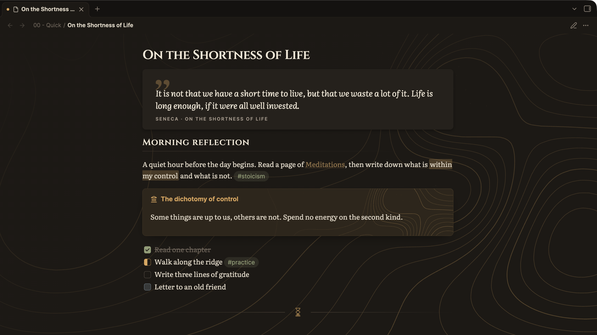

# Umbria

*Umbrian hills at dusk: carved letters, quiet contour lines, the warmth of espresso.*

Umbria is a warm, calm Obsidian theme for everyday notes, journaling and reading.
Dark mode is the heart of it; light mode is soft paper in the same wood.



## Features

- **One accent, earth tones.** Amber accent with moss, rust, slate, plum and honey for everything else. Headings share one ink colour by default; switch to accent or earth-coloured headings in the settings.
- **Four wood tones, each with a dark and a light paper:** Ember (espresso / linen, default), Pine (forest / sage), Autumn (deep red-brown / clay), Ash (neutral charcoal / stone, for anyone who prefers no brown).
- **Contour lines.** A topographic map behind the editor, in empty tabs and in the stoic callout. It fades towards the text, stays sharp on Retina and 5K displays, and takes on your accent colour.
- **Quotes as the centrepiece.** Blockquotes and quote callouts get large serif text and a typographic quotation mark. The callout title is shown as the source underneath the quote.
- **Typography.** Literata for notes, Inter for the interface, Cinzel "inscription" headings (switchable). All fonts are embedded, so nothing is loaded from the internet.
- **Divider ornaments:** contour lines, an hourglass (memento mori), a wave, or none.
- **Tiles:** turn a list of links into a grid of cards with icons, subtitles and image covers. See [Tiles](#tiles).
- **Note layouts:** per-note `cssclasses` for wide notes, image galleries, card views and more. See [Note layouts](#note-layouts).
- **Readable everywhere.** Link text meets WCAG AA on every paper; an optional *Higher contrast* mode raises muted text and borders. Keyboard focus rings use the accent colour.
- **Code, footnotes and embeds:** syntax colours from the palette, a small language label, accent footnote numbers, and embedded notes as soft cards.
- **PDF export and mobile.** PDFs come out on white paper without shadows or contour lines, and tiles stay compact. On phones, quotes, callouts, tiles and tables are tighter.
- **Task states:** `[/]` in progress, `[!]` important, `[?]` question, `[*]` star, `[-]` cancelled, `[>]` deferred.
- **Canvas, Graph and Bases** in the same palette: warm dot grid and soft cards, amber for the active node, Bases tables and cards matching note tables and callouts.
- **Plugin styling** for Dataview, Tasks, Calendar, Day Planner, Excalidraw, Spaced Repetition, Notebook Navigator, Kanban, Banners, Iconize, Outliner and Omnisearch.
- Optional *Memento mori* in the status bar, a *Quiet interface* that fades the ribbon, status bar and inactive tabs until you hover them, and a "no animations" switch.

Try everything at once: copy [`demo/Umbria Showcase.md`](demo/Umbria%20Showcase.md) and [`demo/umbria-hills.svg`](demo/umbria-hills.svg) into your vault.

## Custom callouts

| Callout | Icon | Colour |
|---|---|---|
| `[!quote]` / `[!cite]` | quote | amber, large serif |
| `[!stoic]` | landmark | amber, with contour lines |
| `[!reflection]` | moon | slate |
| `[!practice]` | sprout | moss |
| `[!thought]` | lightbulb | plum |
| `[!gratitude]` | flame | honey |
| `[!journal]` | notebook-pen | slate |
| `[!memento]` | hourglass | stone, inscription title |

```markdown
> [!quote] Seneca · On the Shortness of Life
> It is not that we have a short time to live, but that we waste a lot of it.
```

## Tiles

Turn a plain list of links into a grid of cards, no JavaScript needed:

```markdown
> [!tiles]
> - 🌱 [[Garden]] *Beds and seeds*
> - 📚 [[Reading]] *12 books this year*
> - ![[cover.jpg]] [[Travel]] *Umbria, autumn*
> - [[Home]] #tile/rust
```

- **Whole tile clickable.** The first link in a tile is its target.
- **Icon:** an emoji before the link is shown large above the title.
- **Subtitle:** *italic* text after the link becomes a small line underneath.
- **Cover image:** an embedded image (`![[…]]`) fills the tile, with the title on a soft gradient.
- **Colours** cycle through moss, slate, amber, rust, honey and plum. Give a single tile its own colour with a tag: `#tile/moss`, `#tile/slate`, `#tile/amber`, `#tile/rust`, `#tile/honey`, `#tile/plum` or `#tile/stone`. The tag is hidden inside the tile.

Options go after a pipe and can be combined, e.g. `> [!tiles|cols-3 wide]`:

| Option | Effect |
|---|---|
| `cols-2` … `cols-5` | fixed number of columns (otherwise as many as fit) |
| `small` | lower tiles with smaller text |
| `list` | compact rows with a coloured bar instead of cards |
| `wide` | the first tile spans the whole row |
| `plain` | all tiles in one neutral stone colour |
| `mono` | all tiles in the accent colour |

On phones tiles use two columns (`list` uses one).

## Note layouts

Add these classes to a note's `cssclasses` property:

| Class | Effect |
|---|---|
| `wide` | the note is 40 % wider than the readable line length |
| `max` | the note uses the full width of the pane |
| `table-wide` | tables stretch to the full width |
| `img-grid` | several images in one paragraph form a gallery (Reading view) |
| `cards` | Dataview tables become a grid of cards: the first column is the title, an image column becomes the cover |
| `no-topo` | no contour lines behind this note |

## Settings

Install the [Style Settings](https://github.com/mgmeyers/obsidian-style-settings) plugin to change:

- **Colours:** the wood tone (Ember, Pine, Autumn, Ash) and the accent, moss, rust and slate colours.
- **Type & reading:** heading style (inscription or plain), heading colour (ink, accent title & H1, accent, earth tones), note and interface font, line width (560–1600 px, when *Readable line length* is on), plain quotes.
- **Motif:** contour lines on/off and their strength, the divider ornament, memento mori in the status bar.
- **Calm:** no animations, higher contrast, quiet interface.

## Good to know

- **Fonts:** if you have set your own text or interface font under *Settings → Appearance*, it overrides Umbria's fonts. Clear those fields to see Literata and Inter.

## Installation

- **Community themes:** open *Settings → Appearance → Themes → Manage*, search for *Umbria* and install it.
- **Manually:** download `theme.css` and `manifest.json` from the latest release into the folder `.obsidian/themes/Umbria/` inside your vault, then pick *Umbria* under *Settings → Appearance → Themes*.

## Building from source

`theme.css` is generated. Edit `src/theme.src.css`, then run:

```sh
python3 build.py                     # writes theme.css
python3 build.py --install ~/Documents/Notes # also copies it into the vault at that path
```

The build embeds the fonts from `fonts/` and generates the contour-line SVG (Python 3 standard library only). It also checks the source first: balanced braces, unique Style Settings ids, every settings class actually used, and no leftover placeholders.

See [CHANGELOG.md](CHANGELOG.md) for what changed between versions.

## Licence

Theme: [MIT](LICENSE). Fonts: Inter, Literata and Cinzel under the SIL Open Font License 1.1, see [fonts/OFL.md](fonts/OFL.md).
