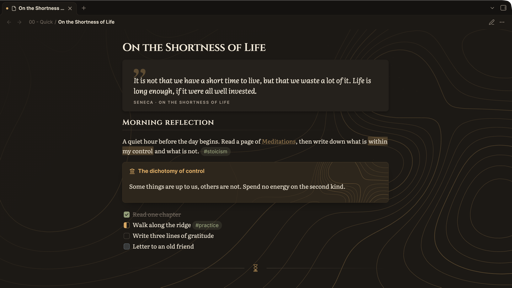

# Umbria

*Umbrian hills at dusk: carved letters, quiet contour lines, the warmth of espresso.*

Umbria is a warm, calm Obsidian theme for everyday notes, journaling and reading.
Dark mode is the heart of it; light mode is soft linen.



## Features

- **One accent, earth tones.** Amber accent with moss, rust, slate, plum and honey for everything else. All headings share one colour and differ only in size and weight.
- **Three wood tones for dark mode:** Ember (espresso, default), Pine (forest green), Autumn (deeper, reddish).
- **Contour lines.** A topographic map behind the editor, in empty tabs and in the stoic callout. It fades towards the text and stays sharp on Retina and 5K displays.
- **Quotes as the centrepiece.** Blockquotes and quote callouts get large serif text and a typographic quotation mark. The callout title becomes the source underneath.
- **Typography.** Literata for notes, Inter for the interface, Cinzel "inscription" headings (switchable). All fonts are embedded, so nothing is loaded from the internet.
- **Divider ornaments:** contour lines, an hourglass (memento mori), a wave, or none.
- **Task states:** `[/]` in progress, `[!]` important, `[-]` cancelled, `[>]` deferred.
- **Plugin styling** for Dataview, Tasks, Calendar, Day Planner, Excalidraw, Spaced Repetition and Notebook Navigator.
- Optional *Memento mori* in the status bar, and a "no animations" switch.

## Custom callouts

Each callout works with its English or its German name.

| Callout | German alias | Icon | Colour |
|---|---|---|---|
| `[!quote]` / `[!cite]` | `[!zitat]` | quote | amber, large serif |
| `[!stoic]` | `[!stoa]` | landmark | amber, with contour lines |
| `[!reflection]` | `[!reflexion]` | moon | slate |
| `[!practice]` | `[!praxis]` | sprout | moss |
| `[!thought]` | `[!gedanke]` | lightbulb | plum |
| `[!gratitude]` | `[!dankbar]` | flame | honey |

```markdown
> It is not that we have a short time to live, but that we waste a lot of it.
> [!quote] Seneca · On the Shortness of Life
```

## Settings

Install the [Style Settings](https://github.com/mgmeyers/obsidian-style-settings) plugin to change:
the wood tone, accent / moss / rust / slate colours, heading style, note and interface font,
line width (560–1600 px, when *Readable line length* is on), plain quotes, contour lines on/off
and their strength, the divider ornament, memento mori and animations.

## Good to know

- **Fonts:** if you have set your own text or interface font under *Settings → Appearance*, it overrides Umbria's fonts. Clear those fields to see Literata and Inter.
- **Contour line colour:** the lines are a background image so they stay crisp at high resolution. That means they keep their amber colour even if you change the accent colour.

## Installation

- **Manually:** download `theme.css` and `manifest.json` into `<vault>/.obsidian/themes/Umbria/`, then pick *Umbria* under *Settings → Appearance → Themes*.
- **Community themes:** coming soon.

## Building from source

`theme.css` is generated. Edit `src/theme.src.css`, then run:

```sh
python3 build.py                     # writes theme.css
python3 build.py --install ~/MyVault # and copies it into a vault
```

The build embeds the fonts from `fonts/` and generates the contour-line SVG (Python 3 standard library only).

## Licence

Theme: [MIT](LICENSE). Fonts: Inter, Literata and Cinzel under the SIL Open Font License 1.1, see [fonts/OFL.md](fonts/OFL.md).

---

## Deutsch

*Umbrische Hügel in der Dämmerung: gemeißelte Buchstaben, ruhige Höhenlinien, die Wärme von Espresso.*

Umbria ist ein warmes, ruhiges Obsidian-Theme für Alltagsnotizen, Tagebuch und Lesen.
Der dunkle Modus ist das Herzstück, der helle Modus ist weiches Leinen.

**Was es bietet:**
- Ein Bernstein-Akzent und Erdtöne (Moos, Rost, Schiefer, Pflaume, Honig). Alle Überschriften haben dieselbe Farbe.
- Drei Holztöne für den dunklen Modus: Glut (Espresso), Kiefer (Waldgrün) und Herbst (rötlich).
- Höhenlinien hinter dem Editor, in leeren Tabs und im Stoa-Callout. Sie bleiben auch auf 5K-Bildschirmen scharf.
- Zitate als Mittelpunkt. Der Callout-Titel wird zur Quelle darunter.
- Literata, Inter und Cinzel sind eingebettet. Es wird nichts aus dem Internet geladen.
- Eigene Callouts mit deutschen Namen: `[!zitat]`, `[!stoa]`, `[!reflexion]`, `[!praxis]`, `[!gedanke]` und `[!dankbar]`. Die englischen Namen stehen in der Tabelle oben.
- Aufgabenstatus `[/]`, `[!]`, `[-]` und `[>]`. Ornamente in Trennlinien. Optional *Memento mori* in der Statusleiste.

**Einstellungen:** Mit dem Plugin *Style Settings* lassen sich Holzton, Farben, Überschriften, Schriften, Zeilenbreite und Höhenlinien einstellen. Die Einstellungen sind auf Englisch beschriftet.

**Hinweise:**
- Eigene Schriften unter *Einstellungen → Darstellung* überschreiben die Theme-Schriften. Leere die Felder, um Literata und Inter zu sehen.
- Die Höhenlinien behalten ihre Bernsteinfarbe, auch wenn du den Akzent änderst.

**Installation:** Lege `theme.css` und `manifest.json` nach `<Vault>/.obsidian/themes/Umbria/` und wähle *Umbria* unter *Einstellungen → Darstellung → Themes*.
